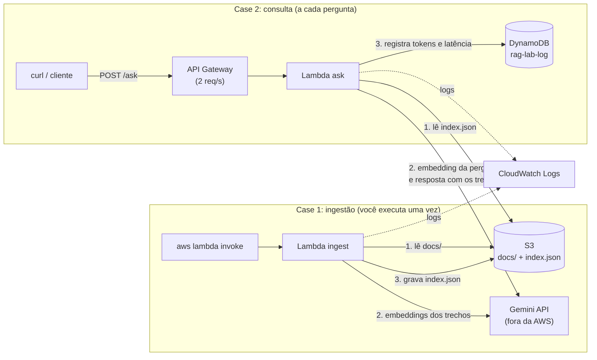

# RAG mínimo no AWS Academy (Terraform + Gemini)

Cria um RAG pequeno, para a aula 4:

- **S3**: guarda os documentos (`docs/`) e o índice (`index.json`).
- **Função `ingest`** (Case 1): lê `docs/` (`.txt`, `.md` e `.pdf`, inclusive escaneado), divide em trechos, gera embeddings no Gemini e grava o índice.
- **Função `ask`** (Case 2): recebe a pergunta, acha os trechos mais próximos, pergunta ao Gemini e responde com as fontes.
- **API Gateway** (`POST /ask`), **DynamoDB** (registro de cada consulta) e **CloudWatch** (logs).

Sem Bedrock e sem banco vetorial gerenciado: o índice é um arquivo JSON e a busca é feita na própria função. Serve para poucos documentos.

## Arquitetura



Como a consulta funciona:

1. A `ask` carrega o `index.json` do S3 (trechos e seus vetores).
2. Gera o embedding da pergunta no Gemini e compara com os vetores do índice (produto escalar de vetores normalizados, igual à similaridade de cosseno), dentro da própria função.
3. Envia ao Gemini a pergunta e os `TOP_K` trechos mais próximos, e devolve a resposta com as fontes (`[docs/...#n]`).
4. Grava no DynamoDB uma linha por consulta, com tokens e latência.

As duas funções usam o `LabRole` e saem para a internet para falar com o Gemini. O bucket é criado pela CLI e só lido pelo Terraform (veja "Por que o bucket não é do Terraform").

## Antes de começar

1. Terraform 1.5 ou mais novo e AWS CLI instalados (no Cloud Shell, veja a seção abaixo).
2. Uma chave do Google AI Studio (https://aistudio.google.com), criada por você.
3. O laboratório do AWS Academy iniciado.

## Passo a passo

```bash
# 1. Credenciais do laboratório (AWS Details > AWS CLI). Mudam a cada Start Lab.
#    No Cloud Shell da AWS este passo não é necessário: as credenciais já vêm na sessão.
export AWS_ACCESS_KEY_ID="..."
export AWS_SECRET_ACCESS_KEY="..."
export AWS_SESSION_TOKEN="..."
export AWS_DEFAULT_REGION=us-east-1

# 2. Chave do Gemini, só no seu terminal. Nunca em arquivo do repositório.
export TF_VAR_gemini_api_key="..."

# 3. Confirme que as credenciais e o LabRole funcionam
aws sts get-caller-identity
aws iam get-role --role-name LabRole --query Role.Arn

# 4. Crie o bucket pela CLI (o Terraform só vai ler este bucket; veja "Por que o bucket não é do Terraform")
ACCOUNT=$(aws sts get-caller-identity --query Account --output text)
aws s3api create-bucket --bucket "rag-lab-docs-$ACCOUNT"

# 5. Terraform
terraform init
terraform plan        # leia o que será criado (11 recursos)
terraform apply       # digite yes

# 6. Envie os documentos e monte o índice
BUCKET=$(terraform output -raw bucket)
aws s3 cp docs-exemplo/ "s3://$BUCKET/docs/" --recursive
aws lambda invoke --function-name "$(terraform output -raw ingest_function)" /dev/stdout

# 7. Pergunte
URL=$(terraform output -raw api_url)
curl -s -X POST "$URL" -H 'Content-Type: application/json' \
  -d '{"question":"Qual o prazo de resposta de uma reclamação formal?"}'
```

Guarde como evidência: a tela do `terraform apply`, a resposta do passo 7 e um registro da tabela DynamoDB.

### Por que o bucket não é do Terraform

Ao criar um bucket, o provedor AWS lê a configuração de Object Lock (`s3:GetBucketObjectLockConfiguration`). A política da organização do AWS Academy (SCP) nega essa leitura, e o `terraform apply` termina em erro `AccessDenied ... explicit deny in a service control policy`. Testado com o provedor 4.67, 5.100 e 6.73: todos falham. A CLI não faz essa leitura, então ela cria o bucket e o Terraform o referencia com `data "aws_s3_bucket"`.

## Rodando no AWS Cloud Shell

O roteiro completo, com instalação do Terraform, limite de 1 GB do `$HOME`, retomada de sessão expirada e problemas comuns, está em [CLOUDSHELL.md](CLOUDSHELL.md).

O `.terraform.lock.hcl` está no repositório e fixa o provedor AWS 5.100.0 e o archive 2.8.1, com hashes para Linux, Windows e macOS. Não apague esse arquivo.

## Testes para conferir que tudo funciona

| Teste | Como | Esperado |
|---|---|---|
| Código das funções (sem AWS) | `python3 tests/test_offline.py` | `Ran 7 tests ... OK` (S3, DynamoDB e Gemini simulados) |
| Credenciais | `aws sts get-caller-identity` | mostra a conta do laboratório |
| LabRole | `aws iam get-role --role-name LabRole` | devolve o papel; se falhar, o laboratório não tem LabRole |
| Saída para a internet | passo 6 (a ingestão chama o Gemini) | `{"ok": true, "chunks": N}` |
| Consulta | passo 7 | resposta com `[docs/...#n]` e `tokens_in`, `tokens_out` |
| Pergunta fora da base | pergunte algo que não está nos documentos (ex.: capital da França) | diz que não encontrou na base |
| Pergunta vazia | envie `{"question":""}` | HTTP 400 |
| Registro | `aws dynamodb scan --table-name "$(terraform output -raw log_table)"` | uma linha por consulta, com tokens e latência |
| PDF | `aws s3 cp docs-pdf/dudh.pdf "s3://$BUCKET/docs/"` e repita o passo 6 | `"transcritos": ["docs/dudh.pdf"]` e os tokens gastos |
| Cache do PDF | repita o passo 6 sem mudar o PDF | resposta sem `transcritos` nem tokens, em poucos segundos |
| Erro tratado | `export TF_VAR_gemini_api_key=invalida`, `terraform apply`, nova pergunta | resposta 502, e o erro (`gemini_400`) fica no registro |

## Custo e limites

- O gasto da AWS aparece no painel do laboratório. O Gemini é cobrado fora da AWS (consulte a página de preços do Google AI Studio).
- O API Gateway limita a 2 chamadas por segundo (`main.tf`, `default_route_settings`).
- A resposta tem teto de `max_output_tokens` (padrão 512).
- A função `ask` tem 30 s de tempo máximo.

### PDF e consumo de tokens do Gemini

O PDF é enviado inteiro ao Gemini, que devolve o texto (serve para PDF escaneado). Isso gasta tokens, então há limites e um cache:

- **Cache:** a transcrição fica em `cache/` no bucket, ligada ao conteúdo do PDF. Repetir a ingestão não gasta tokens, e só um PDF novo ou alterado é transcrito de novo.
- **Custo por PDF:** cerca de 500 tokens de entrada por página e até 8.192 de saída (`MAX_PDF_TOKENS` em `lambda/ingest.py`). Medido com o PDF de exemplo (7 páginas, texto digital): 3.773 de entrada e 2.728 de saída, em 9 s. Um PDF escaneado de 5 páginas gastou 2.649 e 5.392, em 15 s: escaneado gasta mais saída, porque o Gemini lê o texto da imagem.
- **Tamanho:** PDFs acima de 10 MB são ignorados. Se o texto passar de 8.192 tokens (de 7 a 8 páginas de texto escaneado, ou bem mais de texto digital), a transcrição é cortada e a resposta traz o arquivo em `truncados`.
- **Tempo:** a função `ingest` tem 120 s. Sem tempo para outro PDF, ele fica em `pendentes`: rode o passo 6 de novo, e os já transcritos vêm do cache.
- **Cota esgotada (HTTP 429):** o PDF vai para `ignorados` e a ingestão continua com os demais arquivos.
- **A resposta da ingestão mostra `tokens_in` e `tokens_out`** gastos na execução. Para uma turma inteira usando a mesma chave, some o consumo de todos antes de definir quantos PDFs cada aluno pode enviar.
- **PDF de exemplo:** `docs-pdf/dudh.pdf`, a Declaração Universal dos Direitos Humanos em português (ONU, 7 páginas, 49 KB, texto digital, sem dados pessoais). Fica fora de `docs-exemplo/` de propósito: o passo 6 envia essa pasta inteira, e o PDF só deve ser transcrito (e gastar tokens) quando você quiser testar PDF. Fonte: https://www.ohchr.org/sites/default/files/UDHR/Documents/UDHR_Translations/por.pdf
- **Dados pessoais:** o PDF inteiro vai para o Google. Não use documento com CPF, RG ou outro dado pessoal real.

## Segurança

- A chave do Gemini vai como variável de ambiente da função e **fica no `terraform.tfstate`**. Por isso o `.gitignore` bloqueia o state, e o state não pode ser enviado a nenhum repositório nem para a entrega.
- Em uma empresa real, a chave ficaria em um serviço de segredos, e não na variável da função.
- O texto das perguntas e dos trechos vai para o Google. Não use dado pessoal real.

## Desligar tudo

```bash
terraform destroy     # leia a lista e digite yes
aws s3 rb "s3://rag-lab-docs-$ACCOUNT" --force   # o bucket é da CLI, o destroy não o apaga
```

Depois confira no console que não sobrou recurso e encerre o laboratório. Se a credencial expirar no meio, renove (Start Lab, AWS Details) e rode de novo.

## Registro do teste de reprodutibilidade

Executado em 14/11/2026, conta AWS Academy, `us-east-1`, a partir do Windows.

| Item | Resultado |
|---|---|
| Versões | Terraform 1.16.4, AWS provider 5.100.0, archive 2.8.1, Python 3.12 nas funções |
| `terraform validate`, `fmt -check` | passam |
| `tests/test_offline.py` | 7 testes, OK |
| `terraform apply` (11 recursos) | cerca de 20 s |
| Ingestão | `{"ok": true, "chunks": 1}` |
| Consultas (3 perguntas) | HTTP 200, com fonte, 241 a 247 tokens de entrada, 18 a 31 de saída, latência de 0,8 a 1,1 s |
| Pergunta vazia | HTTP 400 |
| Chave inválida | HTTP 502, registrado como `gemini_400` |
| `terraform destroy` + `s3 rb` | 11 recursos destruídos; sem sobras em S3, Lambda, DynamoDB, API Gateway e CloudWatch |

Não testado ainda: execução dentro do Cloud Shell (instalação do Terraform, limite de 1 GB, saída para a internet).

### Teste do suporte a PDF (15/11/2026)

Mesmo ambiente, com `tests/test_offline.py` em 13 testes (6 novos, de PDF) e um teste real na AWS com um PDF escaneado de 5 páginas (2,8 MB, uma certidão de matrícula de imóvel). Esse PDF foi retirado do repositório por conter dados pessoais; o exemplo atual é `docs-pdf/dudh.pdf`, testado na AWS na seção seguinte.

| Item | Resultado |
|---|---|
| Primeira ingestão | 15 trechos; 2.649 tokens de entrada e 5.392 de saída; 15 s |
| Segunda ingestão | 2 s, sem tokens (veio do cache em `cache/`) |
| Perguntas sobre o PDF | HTTP 200, com fonte `docs/<arquivo>.pdf#n`; 1.931 a 1.956 tokens de entrada e 86 a 112 de saída |
| Pergunta sobre o `.txt` com o PDF no índice | resposta correta, com fonte `docs/politica-exemplo.txt#1` |
| `terraform destroy` + `s3 rb` | 11 recursos destruídos; sem sobras |

A transcrição é feita por um modelo e pode ter erros. Eu li as respostas, mas não confrontei o texto inteiro com o PDF.

### Teste do fluxo padrão com a DUDH (15/11/2026)

O fluxo do CLOUDSHELL.md (`docs-exemplo/` mais `docs-pdf/dudh.pdf` no mesmo bucket) foi executado na AWS a partir do Windows, com `terraform apply` e `destroy` completos.

| Item | Resultado |
|---|---|
| Primeira ingestão | 12 trechos; `transcritos: ["docs/dudh.pdf"]`; 3.773 tokens de entrada e 2.728 de saída; 10 s |
| Segunda ingestão | 2 s, sem `transcritos` (cache) |
| Pergunta sobre o prazo de reclamação | "5 dias úteis", fonte `docs/politica-exemplo.txt#1` |
| Pergunta sobre o artigo 1 da DUDH | cita "livres e iguais em dignidade e em direitos", fontes `docs/dudh.pdf#2` e `#3` |
| Pergunta fora da base | "Não encontrei na base." |
| `terraform destroy` + `s3 rb` | 11 recursos destruídos; sem sobras |

## Problemas conhecidos

| Sintoma | Causa | O que fazer |
|---|---|---|
| `AccessDenied ... explicit deny in a service control policy` ao criar o bucket | SCP do laboratório nega `s3:GetBucketObjectLockConfiguration` | Crie o bucket pela CLI (passo 4), como no README |
| `404 ... models/... is not found` nos logs da função | O modelo do Gemini foi aposentado | Troque `gemini_model` em `variables.tf`; confira a lista com a chave em `GET /v1beta/models` |
| `terraform plan` fica parado sem mostrar nada | Sem credenciais AWS na sessão: o provedor tenta o serviço de metadados da EC2 | Refaça o passo 1; confira com `aws sts get-caller-identity` |
| `Error acquiring the state lock` | Outro `terraform` ainda está rodando na pasta | Espere ou encerre o processo; só então use `terraform force-unlock <ID>` |
| `Inconsistent dependency lock file` | Mudou a versão do provedor sem atualizar o lock | `terraform init -upgrade` e depois `terraform providers lock -platform=linux_amd64 -platform=windows_amd64 -platform=darwin_arm64` |
